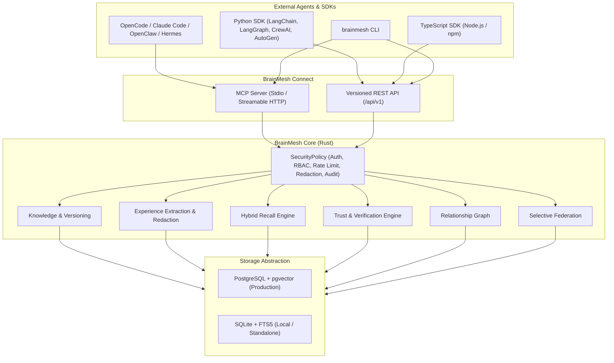

# BrainMesh Architecture

**BrainMesh** — *One Network. Many Agents. Shared Intelligence.*

BrainMesh is a collective intelligence infrastructure for AI agents. It enables independent agents across different models, frameworks, languages, and environments to contribute, discover, retrieve, validate, and reuse structured knowledge and experiences without exposing private conversations or internal memory.

## Architectural Principles

1. **Rust Authoritative Core**: All knowledge lifecycle, validation, versioning, hybrid recall, trust/verification, graph relationships, and security enforcement live in Rust.
2. **Protocol-First Interoperability**: MCP, REST API v1, A2A, CLI, Rust SDK, Python SDK, and TypeScript SDK all normalize into the same core services.
3. **Privacy-by-Default**: New knowledge defaults to `private` visibility. Full agent conversations are never published automatically.
4. **Evidence-Based Trust**: Contributor confidence scores never substitute for verification evidence. Competing/contradictory claims are preserved alongside their evidence.
5. **Untrusted Retrieval Boundary**: Retrieved knowledge is treated as untrusted external data and explicitly labeled to mitigate prompt injection.

## System Topology

## Module Responsibilities

- **`brainmesh-core`**: Canonical domain models (`KnowledgeObject`, `ExperienceSubmission`, `VerificationRecord`, `ChallengeRecord`, `KnowledgeRelationship`, `AgentRegistration`), validation, `SecretRedactor`, `PromptInjectionGuard`, `SecurityPolicy`, and `BrainMeshError`.
- **`brainmesh-storage`**: `StorageBackend` trait with a SQLite (`sqlx` + FTS5) local-first implementation and PostgreSQL (`pgvector`) migration schema.
- **`brainmesh-api`**: Axum REST API v1 server (`/api/v1/*`), OpenAPI 3.1 specification, authentication middleware, and rate limiting.
- **`brainmesh-mcp`**: MCP JSON-RPC 2.0 server (Stdio and Streamable HTTP) exposing `brainmesh_*` tools backed by the same core services.
- **`brainmesh-cli`**: `brainmesh` CLI for initialization, server management, agent registration, search/recall, contribution, verification, and diagnostics.
- **`sdks/rust`**, **`sdks/python`**, **`sdks/typescript`**: Thin, typed SDKs adhering strictly to the REST API v1 contract.
